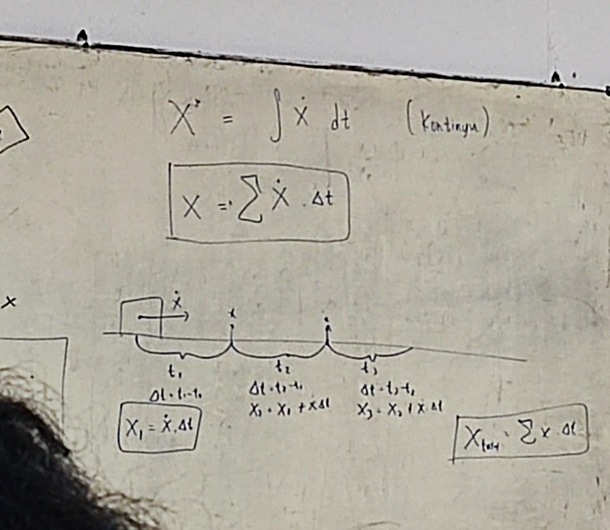
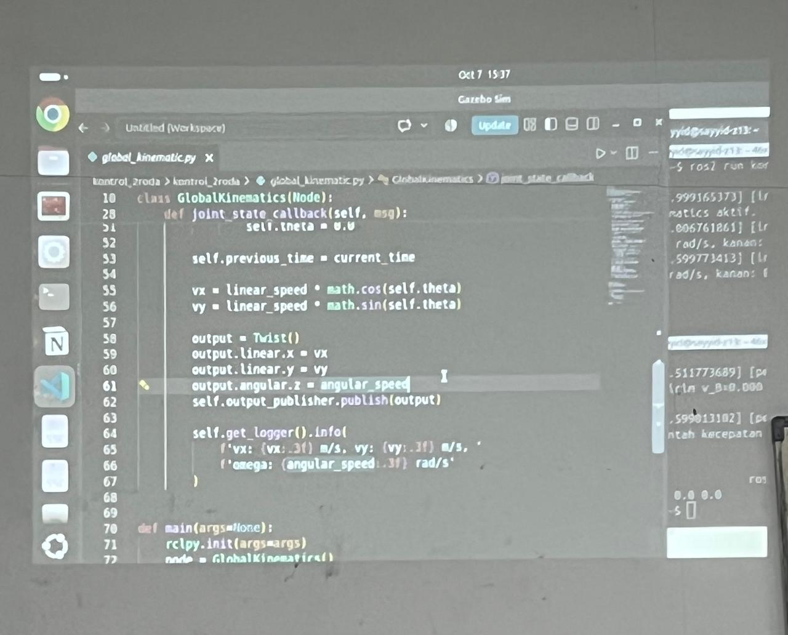

# ROS 2 Global Position & Global Coordinate Velocity

A ROS 2 package for mobile robot kinematics that estimates the robot's global position and calculates its linear velocity components in a global coordinate frame using differential-drive wheel velocities and the robot's heading angle.

The primary focus of this package is **Global Coordinate Velocity**, which transforms the robot's forward linear velocity into global X and Y velocity components. This is useful for mobile robot navigation, trajectory analysis, motion estimation, and coordinate-frame transformations.

## Table of Contents

- [Overview](#overview)
- [Installation](#installation)
- [Usage](#usage)
- [Reference Images](#reference-images)
- [Features](#features)
- [Global Coordinate Velocity](#global-coordinate-velocity)
- [Mathematical Model](#mathematical-model)
- [ROS 2 Topics](#ros-2-topics)
- [Installation](#installation)
- [Debugging](#debugging)
- [Limitations](#limitations)
- [Author](#author)

## Overview

This package provides two ROS 2 nodes:

| Node | Executable | Description |
|---|---|---|
| Get Global Position | `global_position` | Estimates the robot's global X and Y position and heading angle. |
| Get Velocity Global Coordinate | `vel_global_position` | Calculates the robot's linear velocity components along the global X and Y axes. |

Both nodes use wheel velocity information and the robot's motion data to estimate its movement relative to a global reference frame.

## Installation

### Prerequisites

Before installing this package, make sure the following tools are available:

- Ubuntu Linux with ROS 2 installed and configured.
- Git for cloning the repositories.
- `colcon` for building ROS 2 packages.

Install the required build tools if they are not already available:

```bash
sudo apt update
sudo apt install git python3-colcon-common-extensions
```

### 1. Create a ROS 2 Workspace

Create a workspace directory and its `src` folder:

```bash
mkdir -p ~/ros2_ws/src
cd ~/ros2_ws/src
```

### 2. Clone the Required Repositories

Clone all four repositories into the workspace's `src` directory:

**Global Position & Global Coordinate Velocity**
```bash
git clone https://github.com/FabrickDev/ri_global_position.git
```

**Forward and Inverse Kinematics**
```bash
git clone https://github.com/FabrickDev/ri_fk_ik.git
```

**Robot Bringup**
```bash
git clone https://github.com/Bakso14/robin_bringup.git
```

**Robot Description**
```bash
git clone https://github.com/Bakso14/robin_description.git
```

The workspace structure should resemble the following:

```text
ros2_ws/
└── src/
    ├── ri_global_position/
    ├── ri_fk_ik/
    ├── robin_bringup/
    └── robin_description/
```

### 3. Build the Workspace

Source your installed ROS 2 distribution. Replace `<ros_distro>` with the distribution you use, such as `jazzy`.

```bash
source /opt/ros/<ros_distro>/setup.bash
```

Return to the workspace root:

```bash
cd ~/ros2_ws
```

Build all packages:

```bash
colcon build --symlink-install
```

### 4. Source the Workspace

After the build completes successfully, source the workspace:

```bash
source ~/ros2_ws/install/setup.bash
```

To make the workspace available automatically in new Bash terminals, add the following line to `~/.bashrc`:

```bash
source ~/ros2_ws/install/setup.bash
```

Restart the terminal or reload the configuration:

```bash
source ~/.bashrc
```

### 5. Verify the Installation

Check whether ROS 2 recognizes the global position package:

```bash
ros2 pkg list | grep ri_global_position
```

Check the available executables:

```bash
ros2 pkg executables ri_global_position
```

The package should provide the following executables:

- `global_position`
- `vel_global_position`

### 6. Run the Nodes

**Get Global Position**

```bash
ros2 run ri_global_position global_position
```

**Get Velocity Global Coordinate**

```bash
ros2 run ri_global_position vel_global_position
```

Run each command in a separate terminal after sourcing the ROS 2 environment and workspace.

For robot integration, ensure that the required input topics are being published and that the robot bringup and kinematics components are configured correctly.

## Usage

### 1. Get Global Position

Run the global position estimation node:

```bash
ros2 run ri_global_position global_position
```

This node estimates the robot's global position (`PosX`, `PosY`) and heading (`Tetha`) through numerical integration.

### 2. Get Velocity Global Coordinate

Run the global coordinate velocity node:

```bash
ros2 run ri_global_position vel_global_position
```

This node calculates and displays the velocity components along the global coordinate axes.

Example log format:

```text
[LOGGER] DeltaTime: 0.10:
VelX: 0.43 m/s, VelY: 0.25 m/s Omega: 0.10 rad/s
```

The values above are illustrative and do not represent measured output from a specific robot run.

### 3. Enable Detailed Debugging

In the node implementation, set:

```python
self.ShowMoreDebugInfo = True
```

This enables additional diagnostic logs for the variables covered by the debug statements in that implementation.

## Reference Images





## Features

- **Global position estimation:** Estimates planar position using differential-drive kinematics and numerical integration.
- **Global coordinate velocity:** Resolves forward linear velocity into global X and Y components.
- **Heading-based transformation:** Uses the robot's heading angle to determine its direction of movement in the global frame.
- **Angular velocity monitoring:** Displays angular velocity in radians per second.
- **Time interval monitoring:** Calculates elapsed time (`DeltaTime`) between callback executions.
- **Optional debugging:** Provides additional wheel velocity and motion information through a configurable debug flag.

## Global Coordinate Velocity

### What is Global Coordinate Velocity?

A mobile robot typically moves forward relative to its own body coordinate frame. However, navigation and trajectory analysis often require its velocity to be expressed relative to a fixed global coordinate frame.

For example, a robot moving forward while facing the global positive X direction has most of its linear velocity along X. When the robot turns and faces the global positive Y direction, its forward velocity should instead be represented primarily along Y.

The global coordinate velocity node performs this transformation using the robot's linear velocity and heading angle.

The resulting velocity vector is:

```text
V_global = [Vx, Vy]
```

Where:

- \(v_x\): Linear velocity along the global X-axis, in m/s.
- \(v_y\): Linear velocity along the global Y-axis, in m/s.
- \(v\): Forward linear velocity of the robot, in m/s.
- \(\theta\): Robot heading angle relative to the global X-axis, in radians.

### How It Works

The velocity calculation follows these steps:

1. **Read wheel velocities:** Obtain the left and right wheel angular velocities from the ROS 2 topics.
2. **Calculate linear velocity:** Convert the wheel velocities into the robot's forward linear velocity using the wheel radius.
3. **Determine heading:** Use the robot's heading angle relative to the global coordinate frame.
4. **Transform velocity:** Project the forward linear velocity onto the global X and Y axes.
5. **Display results:** Log the time interval, global X velocity, global Y velocity, and angular velocity.

This process converts body-frame forward motion into a global-frame velocity vector.

## Mathematical Model

### 1. Forward Linear Velocity

For a differential-drive robot with equal wheel radii, the forward linear velocity is calculated as:

```text
v = (r / 2) * (ωL + ωR)
```

Where:

- \(r\): Wheel radius, in meters.
- \(\omega_L\): Left wheel angular velocity, in rad/s.
- \(\omega_R\): Right wheel angular velocity, in rad/s.

This equation assumes that both wheel velocity inputs are angular velocities in rad/s.

### 2. Global X Velocity

The robot's forward velocity is projected onto the global X-axis:

```text
Vx = v * cos(θ)
```

### 3. Global Y Velocity

The robot's forward velocity is projected onto the global Y-axis:

```text
Vy = v * sin(θ)
```

Together, these equations describe the transformation from forward linear velocity into global coordinate velocity.

### 4. Angular Velocity

The angular velocity is obtained from the angular Z component of the `/input_ik` topic:

```text
ω = msg.angular.z
```

The unit is rad/s. This value describes the commanded or supplied angular velocity; it is not necessarily a measured physical angular velocity.

## ROS 2 Topics

The nodes use the following input topics:

| Topic | Message Type | Purpose |
|---|---|---|
| `/input_ik` | `geometry_msgs/msg/Twist` | Provides the angular velocity component through `angular.z`. |
| `/left_wheel/command` | `std_msgs/msg/Float64` | Provides the left wheel velocity value. |
| `/right_wheel/command` | `std_msgs/msg/Float64` | Provides the right wheel velocity value. |

The code subscribes to `/input_ik` to trigger the calculation callbacks and to receive the angular velocity input.

**Important:** The wheel topics must contain angular velocity values in rad/s for the stated forward-velocity equation to produce the correct result in m/s.

## Installation

Make sure ROS 2 is installed and sourced in your terminal. Then place the `ri_global_position` package in your ROS 2 workspace's `src` directory.

Example workspace structure:

```text
ros2_ws/
└── src/
    └── ri_global_position/
        ├── package.xml
        ├── setup.py
        ├── setup.cfg
        └── ri_global_position/
            └── ...
```

Build the package:

```bash
cd ~/ros2_ws
colcon build --packages-select ri_global_position
```

Source the workspace:

```bash
source install/setup.bash
```

If the package has not yet been configured with its Python entry points, ensure that `setup.py` registers both executables: `global_position` and `vel_global_position`.

## Debugging

Check whether the required topics are available:

```bash
ros2 topic list
```

Inspect the incoming command:

```bash
ros2 topic echo /input_ik
```

Inspect the left and right wheel velocity values:

```bash
ros2 topic echo /left_wheel/command
ros2 topic echo /right_wheel/command
```

Check the publisher and subscriber connections:

```bash
ros2 topic info /input_ik
ros2 topic info /left_wheel/command
ros2 topic info /right_wheel/command
```

If the output velocity remains zero or does not change as expected, verify that the wheel velocity topics publish the correct units and that the heading angle is updated correctly.

## Limitations

- **Heading initialization:** The robot heading starts at zero. The velocity transformation requires a valid heading estimate relative to the global frame.
- **Heading updates:** In the supplied velocity callback, `Tetha` is not updated. Unless another part of the implementation updates it, the heading remains zero, resulting in vx=v and vy=0. To calculate global velocity during turns, update the heading using a reliable localization source or integrate angular velocity over time.
- **Odometry drift:** The global position estimate relies on wheel velocity and time integration. Errors in wheel measurements, wheel slip, and timing can accumulate.
- **Command versus measurement:** The `/left_wheel/command` and `/right_wheel/command` topics may contain commanded wheel speeds rather than measured speeds. Actual motion estimation is more accurate when measured wheel velocities are available.
- **Time initialization:** The first `DeltaTime` calculation in the supplied position implementation should be initialized carefully to prevent an abnormally large first integration interval.

## Author
Electrical Engineering Class of 2023 C – Industrial Robotics

1. Achmad Syahrul Ramadhan (23050874070)
2. Naufal Herjuno (23050874084)
3. Faqisna Putra Mardhatillah (23050874094)
